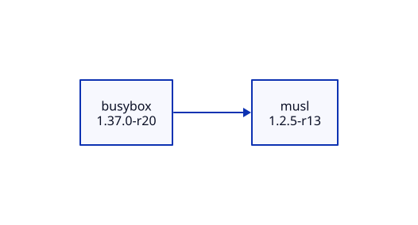
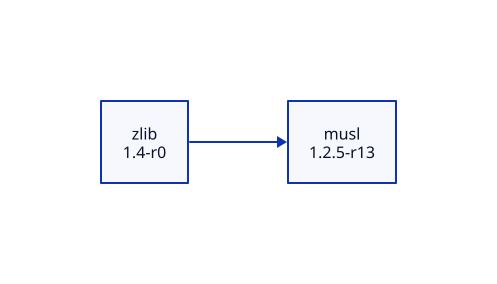
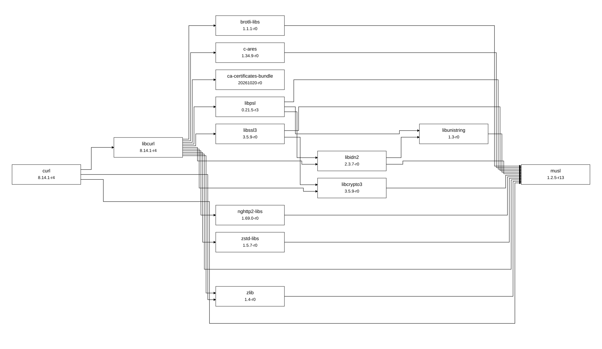

# Граф зависимостей Alpine Linux APK

**Проектная работа №2 · Конфигурационное управление · Вариант №22**  
Тимофеев Антон, ИКБО-70-25. Язык: Python 3.11 или новее.

Инструмент читает официальный индекс пакетов Alpine Linux, строит граф зависимостей и выводит его на языке D2. Получение зависимостей реализовано самостоятельно: используются `urllib.request`, `tarfile`, `tomllib`, `json` и другие модули стандартной библиотеки. Установка Python-пакетов через pip не нужна.

## Структура работы

Каждая папка содержит самостоятельный запускаемый снимок приложения и собственные конфигурации.

| Папка | Результат этапа |
|---|---|
| `stage1` | CLI, TOML, вывод шести параметров, проверка ошибок |
| `stage2` | Чтение APKINDEX, поиск точной версии, прямые зависимости |
| `stage3` | Рекурсивный BFS, глубина, фильтр, циклы, тестовый репозиторий |
| `stage4` | Прямые и обратные зависимости через тот же BFS |
| `stage5` | Вывод D2, три реальных графа, SVG, сравнение с apk dot |
| `tests` | Автоматические проверки конфигурации, данных, алгоритма и CLI |

`build_stages.py` обновляет снимки этапов из финального исходника; константа `STAGE` определяет доступные CLI-операции. Снимки не импортируют код соседних папок. `prepare_examples.py` воспроизводит учебные конфигурации и протоколы демонстраций.

## Быстрый запуск

Открыть PowerShell в корне репозитория:

```powershell
python Workbook2/stage1/depgraph.py
python Workbook2/stage2/depgraph.py
python Workbook2/stage3/depgraph.py
python Workbook2/stage4/depgraph.py --reverse
python Workbook2/stage5/depgraph.py
python -m unittest discover -s Workbook2/tests -v
```

По умолчанию используется `config.toml` рядом с приложением. Можно передать другой файл через `--config`. Этот аргумент выбирает файл, а все параметры анализа берутся именно из TOML.

## Конфигурация

```toml
package = "A"
repository = "repository.json"
test_mode = true
version = "1.0"
max_depth = 10
filter_substring = ""
```

| Параметр | Назначение и проверка |
|---|---|
| `package` | Имя пакета; в тестовом режиме только заглавные латинские буквы |
| `repository` | HTTP(S) URL каталога архитектуры или APKINDEX.tar.gz; в тестовом режиме существующий JSON-файл |
| `test_mode` | Строго TOML boolean: `true` или `false` |
| `version` | Точная версия корневого пакета, начинается с цифры; отсутствующая версия вызывает ошибку |
| `max_depth` | Целое число 0–200; boolean не принимается вместо числа |
| `filter_substring` | Строка без управляющих символов; пустая отключает фильтр |

Относительный путь JSON разрешается относительно TOML, а не текущего каталога. Фильтрация чувствительна к регистру. Если фильтр исключает корневой пакет, конфигурация отклоняется. Неизвестные и отсутствующие ключи, неверные типы и поврежденный TOML вызывают понятную ошибку в stderr с кодом завершения 2. Успешное выполнение возвращает 0. Предел глубины 200 ограничивает рекурсию.

## Этап 1. Минимальный прототип

При запуске выводятся все шесть параметров в формате `ключ = значение`. Каждый параметр проверяется до запуска анализа. Готовые ошибочные конфигурации находятся в `stage1/examples/invalid_*.toml`, фактические сообщения — в `stage1/examples/errors.txt`.

```powershell
python Workbook2/stage1/depgraph.py --config Workbook2/stage1/examples/invalid_max_depth.toml
```

Ожидается: `Ошибка: max_depth: допустимо целое число от 0 до 200`, код 2. Файл ошибок демонстрирует также неверное имя пакета, отсутствующий репозиторий, строку вместо boolean, пустую версию и фильтр, исключающий корень.

## Этап 2. Получение данных

Для реального репозитория приложение загружает `APKINDEX.tar.gz` и читает текстовый член `APKINDEX` без извлечения файлов на диск. Поля `P`, `V`, `D`, `p` задают имя, версию, зависимости и предоставляемые виртуальные имена. Поиск корня выполняется строго по имени и версии. Прямые зависимости выводятся в исходной записи, например `so:libc.musl-x86_64.so.1`. Конфликты с префиксом `!` не являются зависимостями.

```powershell
python Workbook2/stage2/depgraph.py --config Workbook2/stage5/examples/curl.toml
```

У URL должны быть указаны ветка, секция и архитектура, например `https://dl-cdn.alpinelinux.org/alpine/v3.22/main/x86_64`. Ошибки HTTP, сети, архива, кодировки и отсутствия пакета обрабатываются. Тайм-аут сети — 30 секунд; размер архива и текста индекса ограничен 32 МиБ. Сохраненный официальный индекс в примерах позволяет воспроизвести отчет при последующих обновлениях Alpine.

## Этап 3. Рекурсивный BFS

Вершина содержит имя и версию. Корень имеет глубину 0. Рекурсивная функция обрабатывает весь текущий слой BFS, формирует следующий и вызывает себя один раз для следующего уровня. Множество `seen` исключает повторное расширение вершин, но ребра к уже посещенным вершинам сохраняются. Поэтому циклы и ромбы корректно отображаются. Вершины предельной глубины включаются, их зависимости уже не раскрываются.

Фильтр исключает совпадающие пакеты вместе с ребрами к ним, дальнейший обход через них не выполняется. Проверяются как имя зависимости, так и фактическое имя поставщика виртуальной зависимости. При отсутствии подходящей зависимости выводится ошибка вместо неполного графа.

Тестовый репозиторий имеет формат:

```json
{
  "A": {"version": "1.0", "dependencies": ["B"]},
  "B": {"version": "1.0", "dependencies": ["A"]}
}
```

В комплектном графе есть ромб `A → B → D`, `A → C → D`, цикл `D → A`, лист `E` и изолированная вершина `Z`. Все ссылки проверяются при чтении JSON.

| Пример в `stage3/examples` | Ожидаемое поведение |
|---|---|
| `cycle.toml` | 5 достижимых вершин, 6 ребер, цикл сохраняется |
| `depth1.toml` | Только A, B, C; два ребра |
| `depth0.toml` | Только A, без ребер |
| `filter.toml` | B исключен, D остается достижим через C |
| `isolated.toml` | Только Z |

```powershell
python Workbook2/stage3/depgraph.py --config Workbook2/stage3/examples/depth1.toml
```

Фактический вывод каждого случая: `stage3/examples/demo.txt`. Сложность BFS после разрешения зависимостей — O(V + E), память — O(V + E); глубина рекурсии равна числу обработанных уровней.

## Этап 4. Обратные зависимости

```powershell
python Workbook2/stage4/depgraph.py --config Workbook2/stage4/examples/cycle.toml --reverse
python Workbook2/stage4/depgraph.py --config Workbook2/stage4/examples/depth1.toml --reverse
```

Сначала по всему выбранному репозиторию строится обратная смежность, затем вызывается та же функция рекурсивного BFS. Вывод показывает направление обхода: `A → D` означает «от A к зависящему от него D». На глубине 1 для A находится D; на полной глубине находятся также B и C. Корень не считается собственной обратной зависимостью, хотя замыкающее цикл ребро сохраняется. Для Z обратных зависимостей нет. Глубина и фильтр действуют и в этом режиме. Фактические протоколы: `stage4/examples/demo.txt`.

## Этап 5. D2 и визуализация

Финальный CLI выводит только описание D2. Режим `--reverse` относится к этапу 4 и в финальном CLI не предлагается. Идентификаторы и подписи экранируются, порядок вывода стабилен, изолированные вершины сохраняются.

```powershell
python Workbook2/stage5/depgraph.py --config Workbook2/stage5/examples/curl.toml
python Workbook2/stage5/examples/generate_real.py
d2 Workbook2/stage5/examples/curl.d2 Workbook2/stage5/examples/curl.svg
```

Вторая команда воспроизводит три D2-файла из сохраненного индекса стандартной библиотекой Python. D2 нужен только для преобразования готового текста в изображение. При сохранении stdout из Windows PowerShell 5 рекомендуется явно задавать UTF-8; готовые `.d2` уже записаны в UTF-8.

| Пакет и версия | Вершины | Ребра | Результат сравнения с apk dot |
|---|---|---|---|
| busybox 1.37.0-r20 | 2 | 1 | Совпадение |
| zlib 1.4-r0 | 2 | 1 | Совпадение |
| curl 8.14.1-r4 | 14 | 28 | Совпадение |







Снимок загружен 11.11.2026 из Alpine v3.22/main/x86_64. SHA-256, версии и размеры графов записаны в `stage5/examples/snapshot.json`. Для контрольного сравнения запускался штатный `apk dot` в контейнере Alpine с пустой базой установленных пакетов и тем же локальным индексом. Образ закреплен по digest в `compare_apk.py`. Результаты находятся в `*.apk.dot`, сообщения — в `*.apk.stderr.txt`, разности множеств ребер — в `comparison.json`.

```powershell
python Workbook2/stage5/examples/compare_apk.py
```

Для этого отдельного контрольного скрипта требуется работающий Docker. Само приложение не вызывает apk, Docker или сторонние средства получения зависимостей. При сравнении `имя@версия` нормализуется в `имя-версия`, повторяющиеся ребра сворачиваются. Для всех трех примеров разности пусты. Штатный DOT подписывает ребра виртуальными именами `so:...`; наша диаграмма показывает разрешенные пакеты без этих подписей, поэтому оформление отличается при совпадающей структуре.

## Проверки и ограничения

На момент подготовки отчета пройдены 25 автоматических тестов, включая шесть параметров, поврежденные данные, точную версию, виртуальные зависимости, подписанный APKINDEX со склеенными gzip-потоками, сетевую ошибку, циклы, ромбы, фильтр, глубину, обратный обход, стабильность D2 и запуск всех пяти CLI.

Программа является визуализатором одного выбранного репозитория, а не решателем установки APK. Для зависимостей поддерживаются операторы `=`, `<`, `>`, `<=`, `>=`, `~` и виртуальные `provides`; при нескольких кандидатах выбирается максимальная версия, затем имя. Сортировка учитывает числовые части, суффиксы alpha/beta/pre/rc/cvs/svn/git/hg/p и ревизию `-rN`; специальная семантика ведущих нулей Alpine не моделируется. Глобальная совместимость ограничений, приоритеты поставщиков, install_if и объединение main/community не реализованы. Из-за этого на других пакетах возможны расхождения с apk; они не скрываются за неполным результатом. Подпись индекса не проверяется: по умолчанию используется HTTPS, пакеты не скачиваются и не исполняются.

## PDF-версия и сдача

`README.pdf` — печатная версия этого README, сформированная Chromium из `README.html` через механизм печати в PDF, эквивалентный Ctrl+P → «Сохранить как PDF». Для ручного повторения открыть `README.html` в Chrome/Edge, нажать Ctrl+P, выбрать A4 и сохранить PDF. HTML и PDF содержат локальные изображения, подключение к интернету для просмотра не требуется.

Этапы сохраняются отдельными коммитами `feat(workbook2): ...`; итоговый отчет — отдельным коммитом документации. Изменения первой работы не включаются в эти коммиты.

## Источники

- [Официальная документация формата APK](https://github.com/alpinelinux/apk-tools/blob/master/doc/apk-package.5.scd)
- [Исходники и документация apk-tools](https://github.com/alpinelinux/apk-tools)
- [Официальный репозиторий Alpine v3.22](https://dl-cdn.alpinelinux.org/alpine/v3.22/main/x86_64/)
- [Язык диаграмм D2](https://d2lang.com/)
